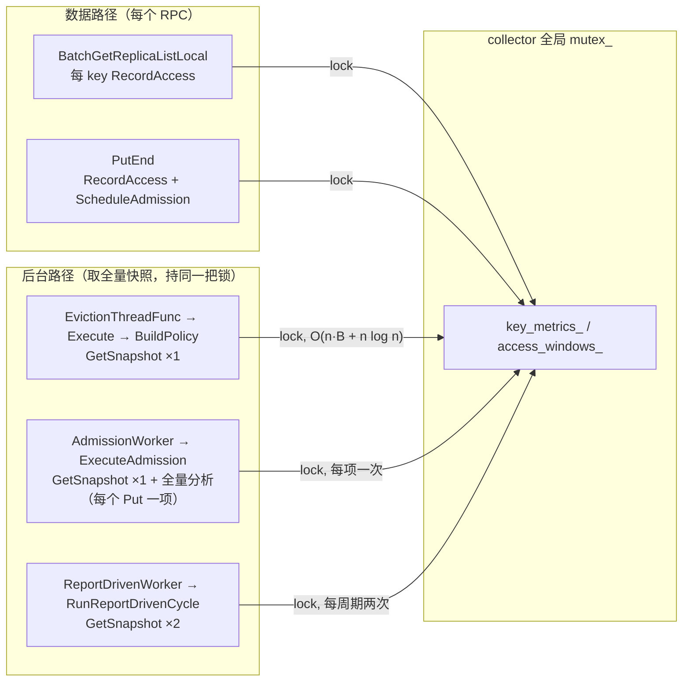

# io_pattern 访问时延劣化评审与冷热分层重构建议

> 评审对象：`mooncake-store/{include,src}/io_pattern/**`（约 120KB）及其在 `master_service.cpp` 中的接线
> 分支：`supercache-snapshot-930` ｜ 评审日期：2026-11-03
> 评审目标（用户给定）：io_pattern 应"优化访问时延、做冷热分层、把热数据放近端"，但现状是 **Put/Get 相对无 io_pattern 前劣化**。
>
> 本文回答四个问题：① 为什么劣化、能优化什么；② 按模块整理问题点；③ 当前工作流程/模式是否合理；④ 业界怎么做冷热识别与决策、有没有更好的算法。
>
> 证据约定：所有结论都带 `文件:行号`。标 **【实测】** 的是仓库内已有埋点/注释记录的测量值；标 **【估算】** 的是基于复杂度与默认参数的推算，需按 §7.3 的方法验证；标 **【推断】** 的是逻辑推演，不是代码事实。
>
> 证据附件（本次评审产生的原始工作底稿，不在 docs 构建树内）：
> - `.zcode/io_pattern_review/01_hotpath_cost.md` —— 热路径成本逐项审计
> - `.zcode/io_pattern_review/02_module_issues.md` —— 约 70 条模块级问题（编号 COL/ANA/POL/EXE/RPT/RT/WIR/DOC，本文直接引用）
> - `.zcode/io_pattern_review/03_industry_survey.md` —— 业界调研（32 条参考文献，全部带 URL）

---

## 1. 结论摘要（TL;DR）

### 1.1 一句话

**劣化不是因为"策略不够聪明"，而是因为采集层被放在了 master 请求关键路径上，并且用"一把全局 mutex + 全量快照排序"来实现它；同时这套子系统默认配置下约 55–65% 的代码不产生任何数据搬移，所以是"纯成本、近零收益"。**

### 1.2 五个可下判断的结论

| # | 结论 | 关键证据 |
|---|---|---|
| C1 | **io_pattern 没有任何总开关**：`IoPatternRuntime` 无条件构造，`report_driven_execution` 硬编码 `true`。用户无法"关掉它回到基线"，只能关三个可选驱动（cold eviction / tier-down / admission 阈值），而这三个恰好默认就是关的。 | `mooncake-store/src/master_service.cpp:573-810`、`:439`；`mooncake-store/src/master.cpp:156-177`（只有三组 flag） |
| C2 | **每次批量 Get 的每个 key、每次 PutEnd 的每个 key 都要走一遍 `RecordAccess`**，单次 `RecordAccess` 要拿 **5 次锁（跨 3 把进程级 mutex，其中 collector 全局锁被取 3 次；每 64 次访问再多 2 次）**，做 7 次 `ObjectRef` 哈希、4–6 次字符串拷贝、1 次 deque 插入，并对该 key 的整个 60s 访问窗口做一次重扫（有界 ≤64 桶）。 | `master_service.cpp:7917-7927`（batch get）、`:8750-8771`（PutEnd）、`io_pattern/runtime.cpp:98-176`、`io_pattern/collector_impl.cpp:87-163` |
| C3 | **采集层的锁与"全量快照"共用同一把全局 mutex**：`GetSnapshot()` 在**持锁状态**下拷贝全部 `key_metrics_`、对每个 key 重算窗口、再全量 `std::sort`。快照期间所有 Get/Put 的 `RecordAccess` 原地排队。 | `io_pattern/collector_impl.h:75`、`io_pattern/collector_impl.cpp:256-283` |
| C4 | **快照的触发点不在"偶尔一次"，而在三条高频后台路径上**：① 内存水位触发的驱逐线程（每次 `Execute` → `BuildPolicy` → 快照）；② 每次 Put 的非 MEMORY 副本 → admission worker → `ExecuteAdmission` → 快照 + 全量分析；③ report-driven worker 每个周期做 **两遍**快照（`runtime.cpp:538` 一次 + `BuildPolicy` 内 `:305` 再取一次）。 | `master_service.cpp:12701-12719`、`:8767-8770` + `io_pattern/runtime.cpp:673-695`、`io_pattern/runtime.cpp:537-601` vs `:300-333` |
| C5 | **"把热数据放近端"在默认配置下没有一条路径会真正发生**：L0(HBM) 被显式拒绝（`UNAVAILABLE_IN_CURRENT_MODE`），prefetch/admission 的执行原语都只是 `TryPushPromotionQueue`，而它要求 `promotion_on_hit=true`（默认 `false`）；tier-down 预算默认 0；cold eviction 默认 `false`。executor 唯一在跑的动作是复用 store 既有的配额驱逐。 | `master_service.cpp:777-808`、`:12145-12149`；`include/master_config.h:57,174,183`；`.zcode/io_pattern_review/02_module_issues.md` §8 |

### 1.3 一个必须先确认的前提（否则一切 A/B 都不可信）

**本分支把单 key Get 的 `RecordAccess` 注释掉了**，留有 `TODO(P99-diag)`：

```cpp
// master_service.cpp:7575-7584
// TODO(P99-diag): 临时禁用 get 路径 RecordAccess（内部 collector/
// observability/feedback_state 多把 mutex 是疑似锁竞争点），A/B 对比
// 定位完成后必须恢复——长期保留会使 io_pattern 丢失 get 侧访问统计
// 输入，驱逐/准入决策退化为无该输入。注意：batch（BatchGetReplicaListLocal）
// 与 put 路径的 RecordAccess 未禁用，A/B 测试需走单 key Get 路径才有效。
// if (record_io_access && io_pattern_runtime_) {
//     io_pattern_runtime_->RecordAccess(key, io_access);
// }
```

含义有三点，评审时必须知道：

1. **主读路径（单 key Get）目前不记录访问**，但 batch get 和 Put 仍然记录 → "劣化"的实测数据取决于压的是哪条路径；
2. 这段注释本身说明**作者已经把 collector 的锁竞争列为 P99 的第一嫌疑**；
3. 对比"有/无 io_pattern"时，单 key Get 的 A/B 已经不成立（两边都不记录），必须用 batch get 或 Put 做 A/B，或先加总开关。

---

## 2. 问题一：为什么加了 io_pattern 反而劣化

### 2.1 事实基线：请求路径上到底多做了什么

| 路径 | io_pattern 做的动作 | 位置 |
|---|---|---|
| `BatchGetReplicaListLocal`（每 key） | 构造 `AccessRecord`（含 `key` 字符串拷贝 + 一次 `steady_clock`），随后逐 key `RecordAccess` | `master_service.cpp:7887-7904`（构造）、`:7917-7927`（记录） |
| `PutEnd`（每 key） | `RecordAccess`（kPut）+ 非 MEMORY 副本额外 `ScheduleAdmission` | `master_service.cpp:8750-8771` |
| ↑ 注意：正常客户端 PutEnd 传的是 **`ReplicaType::ALL`** | ⇒ 条件 `replica_type != ReplicaType::MEMORY` 恒真 ⇒ **每个 Put 都 `ScheduleAdmission`**；且 `tier` 三元表达式对 `ALL` 落到 `kL3NofSsd`（把刚写进 DRAM 的对象记成远端 SSD）——**tier 位错误也发生在 Put 路径上，不只 tier-down** | `client_service.cpp:3243`（`process_end_group(..., ReplicaType::ALL)`）；`master_service.cpp:8758-8769` |
| `GetReplicaListLocal`（单 key） | 仍然构造完整 `AccessRecord`（字符串拷贝 + 取时钟），但**不使用**（被注释） | `master_service.cpp:7543-7559`、`:7580-7584` |
| 内存水位驱逐（每次触发） | `RecordStorageMetric` + `Execute()`：全量快照 → 分析 → 策略 → 执行；**取代了原来的 `BatchEvict`**，不足额时再回退 `BatchEvict` | `master_service.cpp:12701-12719`、`:767-775` |
| 副本插入/移除 | `RecordTierEvent`（collector 锁） | `master_service.cpp:11677,11766,12702,13333` |
| 接收 CFM 上报（每 access） | RPC 线程上逐条 `RecordAccess` | `io_pattern/cfm_ingress.cpp:28-34` |

`IoPatternRuntime` 的注释声称 "collection never blocks the data path"（`io_pattern/runtime.h:28-30`），**这个说法与实现不符**：采集本身就是数据路径的一部分，且自带全局锁。

### 2.2 三条强制成本（不是可选项）

**强制成本 1：每次访问的 `RecordAccess` 固定开销。**

`io_pattern/runtime.cpp:98-176` 一圈做下来：

| 步骤 | 加锁 | 代价来源 |
|---|---|---|
| `collector_->dropped()` | collector 全局 mutex ×1 | 只为算 dropped 差值 |
| `collector_->RecordAccess()` | collector 全局 mutex ×1 | 见下方拆解 |
| `observability_.RecordCollectLatency()` | observability mutex ×1 | 每访问一次计时统计 |
| `collector_->dropped()`（再取一次） | collector 全局 mutex ×1 | 同上 |
| `feedback_state_mutex_` 临界区 | feedback_state mutex ×1 | `++feedback_accesses_`、`pending_prefetches_.erase(ObjectRef)`（哈希 + 字符串比较） |
| 每 64 次访问触发 `RecordFeedback` | feedback_state mutex **×2** + policy engine 锁 | `feedback_.Record` + `tuner_.Tune` + 可能 `ApplyEvictionTuning` |

即 **单次访问 5 次加锁、3 把不同的 mutex**（collector 全局锁被取 3 次；每 64 次访问再多 2 次 feedback 锁并可能触发调参）。`collector_->RecordAccess` 内部（`io_pattern/collector_impl.cpp:87-163`）还有：

- `ObjectRef object = record.object;` + `object.key = key;` —— 键被**拷贝两遍**（调用方本来已经把同一个 key 传了两遍：`RecordAccess(key, record)` 而 `record.object.key` 也是它，见 `master_service.cpp:7924`）；
- `key_metrics_.contains(object)` **连查 3 次** + `key_metrics_[object]` 第 4 次哈希；
- `access_windows_[object]` 第 5 次哈希（`ObjectRef` 含 tenant + key 两个 string，每次哈希都要过两段字符串）；
- deque 上 `std::lower_bound` + `insert`；
- 末尾 `ApplyAccessWindow()`（`collector_impl.cpp:17-52`）**把该 key 的整个访问窗口重扫一遍**重算 `access_count_window / write_frequency / overwrite_ratio / write_burst`。

窗口参数：`access_window_ns = 60s`、`access_bucket_ns = 1s`、`max_access_buckets_per_key = 64`（`include/io_pattern/collector_impl.h:22-24`）→ 单次访问最多扫 64 个桶（**有界常数，不是无界 O(n²)**；真正的 O(K²) 在策略层 `FindPattern`，见 §3.3 POL-1）。

**【估算】** 无竞争时单次 `RecordAccess` ≈ 0.6–1.2µs（5 次 lock/unlock ≈ 100–150ns、2 次字符串拷贝 ≈ 50–100ns、5 次含双字符串的哈希 ≈ 150–250ns、deque 插入 + 窗口重扫 ≈ 200–300ns、timer/TLS 打点未计入）。**16 key 的批量 Get 因此额外 10–20µs**；这是"每请求"尺度的成本，不是"每周期"。

**强制成本 2：全量快照持全局锁。**

```cpp
// io_pattern/collector_impl.cpp:256-283
IoPatternSnapshot IoPatternCollectorImpl::GetSnapshot() const {
    std::lock_guard lock(mutex_);           // ← 全局锁
    snapshot.keys.reserve(key_metrics_.size());
    for (const auto& [object, metrics] : key_metrics_) {
        auto copy = metrics;                 // 拷贝（含 2 个 std::string）
        ApplyAccessWindow(object, ...);      // 每 key 再扫一遍窗口
        ...
        snapshot.keys.push_back(std::move(copy));
    }
    std::sort(snapshot.keys.begin(), snapshot.keys.end(), ...);  // O(n log n)
}
```

复杂度 **O(n·B + n log n)**（n = 保留的 key 数，默认上限 10 万，见 §3.7 WIR-5），**全程持锁**。因此它的真实代价不是"快照本身慢"，而是"**快照期间整条数据路径停摆**"。

**强制成本 3：`TryPushPromotionQueue` 之外的重复热度机制。**

master 本来就有基于 **CountMinSketch** 的 promotion-on-hit 频率准入（`master_service.cpp:423`、`:12145-12165`，阈值 `promotion_admission_threshold=2`）。io_pattern 的 prefetch/admission handler 最终**也只是调 `TryPushPromotionQueue`**（`master_service.cpp:777-808`）。也就是说：master 已经有"轻量频率草图 + 提升队列"这一套，io_pattern 又在其上叠了一层"per-key map + 全量快照 + 分类器 + 四层加权评分"，而**最终动作完全相同**。

### 2.3 真正的放大器：谁在触发全量快照

单次 `RecordAccess` 是微秒级；把它变成 **P99 尖刺**的是"后台路径反复取全量快照，且锁是同一把"。



| 触发点 | 频率 | 每次代价 | 证据 |
|---|---|---|---|
| **驱逐线程**（内存水位超限，默认 0.90） | 压力期**每 10ms 一轮**（`kEvictionThreadSleepMs=10`），每轮都会重跑下面整条管道 | 1× 快照 + 全量分析（默认预算 500ms）+ 策略（逐候选线性查找，O(n·k)）+ 驱逐执行；**取代了原来的 `BatchEvict`** | `master_service.cpp:12689-12719`；`include/types.h:93`；`include/master_service.h:2072-2073`；`io_pattern/runtime.cpp:300-333`；`io_pattern/policy_strategies.cpp:10-24` |
| **admission worker** | **每个非 MEMORY 副本的 Put**（`replica_type != MEMORY` 就入队） | 1× 快照 + 1× 全量分析 + 1× 决策，**串行单线程**；而 handler 因 `promotion_on_hit=false` 恒返回 `UNAVAILABLE_IN_CURRENT_MODE`（纯白做） | `master_service.cpp:8767-8770`；`io_pattern/runtime.cpp:633-695`；`master_service.cpp:807` + `include/master_config.h:174` |
| **report-driven worker** | 每个 merge 的 report（外部上报）+ 周期 tick（默认 10s，但 tick 只在 cold/tier-down 配置时唤醒） | **2× 快照** + 2× 分析 + 3 次全量扫描（`DeriveTraceHistory`/`DeriveAdmissionCandidates` 各扫全量）+ 每周期 O(n) 引擎重建 | `io_pattern/runtime.cpp:537-601`（快照 @538）与 `:300-305`（快照 @305）；`:316` `SetSessionWorkloads`；`policy_engine.h:202-212` |

**关键推论（这是"为什么劣化"的核心机制）**：

【推断】设 key 数 n = 10 万，单次快照含字符串拷贝、逐 key 窗口重扫、全量排序，保守按 **每 10 万 key 5–20ms** 估算（仅字符串拷贝 10 万 × 2 ≈ 数 ms，加排序与逐 key 重扫）。则：

- 一次水位驱逐 = 数据路径被堵 5–20ms；
- 每个 Put 的 admission 项 = 又堵 5–20ms（worker 串行，Put 速率一高就永远追不上，锁被持续占用）；
- 10s tick（若开启）同样；
- **且这是"全局锁"**：32 核上跑的 RPC 线程全部在这把锁上串行，**吞吐上限与核数无关**。

这就是"加了 io_pattern 反而慢"的充分解释：不是采样逻辑错，而是**把 O(1) 的热点采集和高频 O(n) 的聚合放在了同一条临界区上**。

#### 2.3.1 跨路径耦合：**Put 是"持着分片写锁"去等 collector 锁的**

这一条是把"微秒级成本"放大成"毫秒级尾延迟"的关键，也是 Get 被 Put 连带拖慢的机制：

```cpp
// master_service.cpp:8593-8606  PutEndInternal 入口
std::shared_lock<std::shared_mutex> shared_lock(snapshot_mutex_);   // ← 全局快照读锁
...
MetadataAccessorRW accessor(this, object_id);                        // ← 分片写锁（RW accessor）
...
// master_service.cpp:8750 仍在 accessor 作用域内（accessor 直到函数尾 8784 才析构）
if (io_pattern_runtime_) {
    io_pattern_runtime_->RecordAccess(key, {...});                   // ← 在分片写锁内取 collector 全局锁
    ...
}
```

锁序是 `snapshot_mutex_` → 分片写锁 → **collector 全局锁**。于是：

1. 后台 `GetSnapshot`（驱逐/admission/report 周期）持有 collector 锁 ms 级；
2. 一个 `PutEnd` 拿到分片写锁后，卡在 collector 锁上；
3. **该分片上的所有其它 Get/Put（同 shard 任意 key）全部排队**——即使它们跟这个 key 毫无关系。

这就是"Put/Get 一起变慢"的直接传导链：**后台聚合的锁持有时间 → 被 Put 的分片写锁放大成正个分片停摆**。

【推断】同一模式也出现在 `BatchGetReplicaListLocal`：`AccessRecord` 在分片读锁内构造（`master_service.cpp:7803-7907`、`:7887-7904`），`RecordAccess` 在 `snapshot_mutex_` 共享锁内执行（`:7801` 声明、`:7928` 才释放）→ 读锁持有时间被拉长，与 PutEnd 的写锁互相排队（Get 拖慢 Put、Put 拖慢 Get）。

#### 2.3.2 成本份额估算（仅用于排序，不是精确配比）

假设：真实客户端 Put 走 `ReplicaType::ALL`（会触发 admission）、collector 观测 key 数 1e4–1e5、并发 8–56 线程、SpDiag Layer0（打点零成本）。

| 排名 | 成本项 | 是否可关 | 触发频率 | 估算份额 |
|---|---|---|---|---|
| 1 | Put → `ScheduleAdmission` → 每 key 一次全量 `GetSnapshot` + 分析 | **强制** | 每个真实 Put | **35–45%** |
| 2 | `RecordAccess` 本体（5 锁 / 3 个进程级 mutex / 7 次哈希 / 4–6 次 string 拷贝），其中 PutEnd 在分片写锁内 | **强制** | 每次 Put、每个 BatchGet key | **25–35%** |
| 3 | 水位淘汰被整体换成 io_pattern `Execute`（全局锁快照 + O(K²) 策略 + 逐候选分片锁），水位 >0.90 时**每 10ms 一次** | **强制** | 压力期持续 | **10–20%**（尾延迟主因） |
| 4 | BatchGet 的 `AccessRecord` 构造在分片读锁内 + vector 无 `reserve` | **强制** | 每个 BatchGet key | **5–10%** |
| 5 | report 周期 2× `GetSnapshot` | 强制（但需有上报） | 每次 CFM report | 0–10%（部署相关，未证实） |
| 6 | 单 key Get 残余 `io_access` 组装（钩子已注释） | 强制残余 | 每次单 key Get | 1–3% |
| 7 | tier 事件 / `ReportEvictedKeysAsTierRemovals` 逐 key 分片锁往返 | 强制 | 每次 offload/淘汰 | 1–3% |
| 8 | SpDiag 打点（仅 Layer1 构建；Layer0 为空实现） | 编译期可选 | 每次请求 | 3–8%（**A/B 必须固定同一构建层**） |

> 关键补充：**水位淘汰的触发节奏**是 `used_ratio > eviction_high_watermark_ratio_`（默认 **0.90**，`include/types.h:93`）+ `kEvictionThreadSleepMs = 10`（`include/master_service.h:2072-2073`）→ 一旦进入压力状态，驱逐线程**每 10ms 就跑一遍完整 io_pattern 管道**（含持全局锁的全量快照）。如果单次快照 >10ms，则 collector 锁被持续占用 → 数据面完全被压住。这是"压力越大越慢、越慢越压力"的正反馈。
>
> 另：`if (io_pattern_runtime_) { Execute } else { BatchEvict }`（`master_service.cpp:12701-12719`）中，`io_pattern_runtime_` 在 `:573` **无条件构造** → **`else` 分支永远不可达**，即"回到纯 LRU 驱逐"在运行时无法配置出来。

### 2.4 仓库里已有的实测线索

`mooncake-integration/store/mooncake_perf_points.def:176-200` 记录了当时的归因结论（**这是仓库内既有实测**）：

```
// Batch get 服务端归因：锁获取（snapshot_mutex_ 共享锁 + shard 读锁）vs
// 副本构建（逐 key 元数据查找 + 响应组装）。对照 449µs avg / 24.6µs min。
// 二轮归因（锁 74ns / 构建 2.5µs 已排除，剩余 ~415µs 在未覆盖段）：
// GroupRoute:    group_routing_mutex_ 路由阶段整窗（16 key 的 MakeScopedKey ...）
// RecordAccess:  io_pattern_runtime_->RecordAccess 逐 key 记录（每 shard 访问
//                1 tick，930 特性访问模式统计的潜在重活）。
// HandlerConvert: rpc 层响应转换+序列化整窗 ...
```

读法（重要，避免误判）：

- **449µs avg 对 24.6µs min**：说明存在严重的**尾部分散**（约 18×），这正是"偶发长时间持锁"的特征，而不是"每请求固定慢一点"的特征；
- 锁 74ns、构建 2.5µs 已被排除 → **剩余 ~415µs 落在三个未覆盖段**：`GroupRoute`、`RecordAccess`、`HandlerConvert`；
- 该文件已经把 `RecordAccess` 内部的 `MASTER_IO_*` 埋点全部定义好（`:195-200`：DroppedBefore / CollectorRecord / CollectLatency / DroppedAfter / FeedbackUpdate / FeedbackRecord），**且写明了归因假设**："DroppedBefore/After 本征 ~100ns，avg 显著偏高 = collector mutex 被后台路径（GetSnapshot/FlushReports/MergeSnapshot）持有"。

也就是说：**作者已经完成了"假设 → 埋点"这一步，缺的只是把 `MASTER_IO_*` 与 `MASTER_GET_IO_RECORD` 的实测值跑出来**。§7.3 给了复现方法。本文不臆造 415µs 的归属，但给出结论：**该段的主要可疑对象与本文 §2.2/§2.3 的机制完全一致**。

### 2.5 为什么"就算不劣化，也赚不回来"（收益上限论证）

这一节回答"那把这些成本优化掉，io_pattern 值不值得留"。

**收益来源只有一条**：把"下一次访问某 key 时它在 LOCAL_DISK/L3"变成"它在 L1 host DRAM"，节省一次磁盘/远端读（毫秒级）。收益 = `P(该 key 被再次访问) × 命中时节省的时延 − 搬移成本`。

而现状：

1. **L0(HBM) 不归 master 管**，`kL0Hbm` 直接返回 `UNAVAILABLE_IN_CURRENT_MODE`（`master_service.cpp:784-786`、`:802-804`）。所以"热数据放近端"的"近端"只能是 host DRAM，而 **host DRAM 本来就是 Put 的默认落点** → tier-up 只对"已经被降级/淘汰到盘上、又被读"的 key 有意义。
2. **tier-down 不省时延，只是"提前把数据搬到盘上"**：`TryQueueTierDown` 复制 MEMORY→LOCAL_DISK **并保留 MEMORY 副本**（`master_service.cpp:623-650` 的语义），既没释放内存、也没有让任何一次访问变快；它的唯一作用是让"以后驱逐这个 key"更便宜。默认预算 0。
3. **cold eviction（低于水位主动驱逐冷的 key）在没有内存压力时是纯损失**：驱走一个 key 不会让任何访问变快，只会把未来的命中变成 miss。默认 `false`（正确）。
4. **prefetch/admission 只落到 promotion 队列**，而 `promotion_on_hit` 默认 `false` → 默认根本不搬（`master_service.cpp:777-808`、`:12145-12149`）。
5. **决策质量受输入限制**：Store 侧 `AccessRecord` 没有 `token_count / prefix_fanout / match_length / recompute_cost`（这些只有推理连接器知道），所以 `ThresholdAnalyzer` 在 Store 路径几乎恒判 `kMixed`（`io_pattern/threshold_analyzer.cpp:117-138`），KMeans 因此几乎每次运行，而 session 为空导致"每个 key 一个 session"（`io_pattern/kmeans_analyzer.cpp:69-80`）——分类结果不携带信息。

【推断】结论：**在默认配置下，io_pattern 的期望收益 ≈ 0，而成本是"每请求 6 次加锁 + 周期性 O(n) 全局停顿"**。这不是调参能修的比例问题，而是"成本项与收益项不在同一个数量级"的结构问题。

### 2.6 劣化机制排序（回答"分析下原因和可以优化的点"）

| 排名 | 机制 | 为什么会体现在 Put/Get 上 | 优化方向 |
|---|---|---|---|
| 1 | **每个 Put 都触发 admission worker 的一次全量快照 + 分析**（份额最大 35–45%） | 真实客户端 Put 走 `ReplicaType::ALL` → 必入队；worker 串行，每项 O(n) 且持 collector 全局锁；handler 默认恒失败 | 直接删除该 hook（默认不可用）；或改为"入队计数 + 周期性批量评估" |
| 2 | **每次访问 6 次加锁 + 4 次哈希 + 字符串拷贝 + 窗口重扫，且 PutEnd 在分片写锁内** | 每个 batch-get key / 每个 Put 都付一次；分片写锁把 io_pattern 等待放大到整分片 | 数据面只做一次"无锁原子计数"或 1/N 采样；删除 `dropped()` 双取、`ApplyAccessWindow` 重扫；采集移出分片锁 |
| 3 | **全局 collector mutex × 全量快照**（放大器） | 快照 O(n·B + n log n) 持锁期间，所有 `RecordAccess` 排队；n=10 万时是 ms 级；压力期每 10ms 一次 | 分片（按 tenant/key 哈希）+ 增量快照 + 只导出候选集；数据面路径不碰同一把锁 |
| 4 | **驱逐路径被策略引擎接管（1× 快照 + 全量分析 + O(n·k) 候选线性查找）** | 内存压力时驱逐变慢 → 压力持续更久 → 更多驱逐（正反馈） | 候选选择改为单遍 top-k（堆）；或压力路径回退到纯 LRU `BatchEvict` |
| 5 | **report-driven worker 每周期 2× 快照 + O(n) 引擎重建** | 一旦接入上报或开 tick，周期成本 = 2×快照 | 复用一次快照；引擎按 workload 类型缓存（≤4 个）而非按 session/key |
| 6 | **每次分析 `std::thread().detach()` + 500ms 超时后 fallback 复制整份结果** | 分析超时后周期退化，但线程继续烧 CPU 并占锁 | 固定分析线程 + 可取消；超时返回保守常量而非拷贝 |
| 7 | **日志风暴**：每个驱逐周期多条 `LOG(WARNING)`（含候选 key 名）、每个 report 周期一条 `LOG(INFO)` | 压力期正好是日志最密集期 | 降级为 VLOG / 限频 / 计数器 |

---

## 3. 问题二：按 io_pattern 模块分类的问题点

> 完整条目（约 70 条，含代码引用与修复建议）见 `.zcode/io_pattern_review/02_module_issues.md`。本节给出每模块的**结构性问题**与代表性 ID，按"是否默认在跑 / 是否在热路径 / 对时延影响 / 对目标贡献"定位。

### 3.0 模块状态总览

| 模块 | 默认是否在跑 | 在 master 数据路径上 | 对 Get/Put 时延 | 对"热数据就近"的贡献 |
|---|---|---|---|---|
| 采集 `collector_impl` | 是（Put、batch-get；单 key Get 被禁用） | **是** | **高** | 仅提供输入 |
| 分析 `threshold/sliding/kmeans/resilient` | 是（每个策略周期 + 每个 admission 项） | 否（后台线程） | 中–高 | 无（只改权重） |
| 策略 `policy_engine/policy_strategies/degrading` | 是 | 否 | 中（O(n·k)） | 仅决定驱逐对象 |
| 执行 eviction handler | 是（水位触发） | 否（驱逐线程） | 中 | 有（但只是复用既有配额驱逐） |
| 执行 prefetch/admission handler | admission **任务被调度**，handler 默认恒失败 | 否 | **高**（Put 外挂 O(n)） | 0 |
| tier-down / cold-eviction driver | 否（默认关） | — | 0 | 0 |
| report-driven worker | 线程常驻，默认无报告 | 否 | 0（空转） | 0 |
| CFM 上报（client/channel/reporter） | 否（仅 bench/测试） | 否 | 0 | 0 |
| feedback/tuner | 半跑（每 64 访问 + 每周期） | **是**（数据路径加锁） | 低–中 | 0（信号恒常数） |

**inert 占比【估算】55–65%**：reporter、cfm 客户端/通道、kmeans 输出、registry/pool/resilient、legacy fallback、tier-down、cold eviction、prefetch 默认全部不产生有效决策。**能改变数据放置的代码在默认配置下为 0 行**。

### 3.1 采集层（`collector_impl.{h,cpp}`）

| ID | 级别 | 问题 | 证据 |
|---|---|---|---|
| COL-1 | **P0** | 全部租户/全部 key 共用**一把** `std::mutex`；`RecordAccess / MergeSnapshot / GetSnapshot / dropped()` 全部串行；`GetSnapshot` 在锁内做全量拷贝 + 逐 key 窗口重扫 + 全量排序 | `include/io_pattern/collector_impl.h:75`；`src/io_pattern/collector_impl.cpp:257,260-283` |
| COL-2 | **P0** | 单次 `RecordAccess` 固定成本高：同 key 4 次 hash、`ObjectRef` 双字符串拷贝（调用方已传了两份 key）、deque `lower_bound`+`insert`、末尾全窗重扫 | `collector_impl.cpp:91-92,93-105,111-163` |
| COL-3 | P1 | 持 collector 锁时调用 `reporter_->Enqueue*`（collector→reporter 双锁嵌套 + 每次访问一个 `std::function` 堆分配）；master 当前未接 sink，但一旦接线即落在访问路径 | `collector_impl.cpp:56-57,90`；`reporter.cpp:43-59` |
| COL-4 | P1 | 配额/降级**粘性**：`key_metrics_`/`tenant_key_counts_` 永不淘汰；`degraded_` 置 true 永不复位 → key 数超 10 万后每次访问直接丢弃、每周期 `degraded=true` → 3 次后策略永久降级 | `collector_impl.cpp:58-72,93-105,179-199`；`runtime.cpp:325-328`；`degrading_policy_engine.cpp:5-10` |
| COL-5 | P1 | `MergeSnapshot` 用 `key_metrics_[object] = metrics` **整体覆盖**本地指标（含 `replica_tiers/pinned/session_id`），并 `window.clear()` 重置滚动窗口 → 远端上报污染本地真实副本位图 | `collector_impl.cpp:179-219` |
| COL-6 | P2 | 远端快照 `last_access_time_ns` 未做时钟 rebase（`cfm_ingress` 只 rebase 了 access/storage）→ `idle_time_us` 失真 | `collector_impl.cpp:200,264-268` vs `cfm_ingress.cpp:28-42` |
| COL-7 | P2 | `active` 只置 true 永不复位，而 Put 记录 `is_hit=true` → **每个写过的 key 永远 active**，冷热判断把"写过"当"热" | `collector_impl.cpp:157`；`master_service.cpp:8764` |
| COL-8 | P2 | `dropped()` 每次单独加锁，而 runtime 在**每次访问**里调两次 | `collector_impl.cpp:285-293`；`runtime.cpp:104-137` |
| COL-9 | P2 | `GetSnapshot` 每 key 拷两份 `std::string` 并按 (tenant,key) 全量排序；无增量/版本号 | `collector_impl.cpp:260-281` |
| COL-10 | P2 | 副本位图与真实元数据长期不一致：插入时把 LOCAL_DISK 记成 `kL3NofSsd`，且只有 L1 发 `kRemoved` | `master_service.cpp:11677-11683,13321-13338` |

### 3.2 分析层（`threshold/sliding_window/kmeans/resilient`）

| ID | 级别 | 问题 | 证据 |
|---|---|---|---|
| ANA-1 | **P0** | **每次分析都新建一个 detached `std::thread`** + promise/future；`analysis_timeout_us` 默认 500000（500ms），超时后返回 fallback 但线程继续跑、无取消；期间 `analysis_in_flight_` 保持 true，后续周期全走 fallback | `runtime.cpp:213-242`；`runtime.h:82` |
| ANA-2 | P1 | `SlidingWindowAnalyzer::Aggregate` 每次从**整个保留历史**重建 `unordered_map<ObjectRef,KeyMetrics>` 再排序（历史 60s、上限 20 万 key）→ 每次分析 O(history) | `sliding_window_analyzer.cpp:16-36,39-78` |
| ANA-3 | P1 | Store 路径几乎必然走 KMeans（推理字段全 0 → 恒 `kMixed`），而 session 为空 → **每个 key 一个 session**，迭代 `it × sessions × 3`，最后还重跑一遍完整阈值分析 | `threshold_analyzer.cpp:117-138`；`sliding_window_analyzer.cpp:80-87`；`kmeans_analyzer.cpp:59-144` |
| ANA-4 | P1 | 分类不稳定却被当真值：任一 key 命中规则即判整体 workload；kmeans 取 `labels[assignments.front()]` 而 `by_session` 是 `unordered_map`（**结果依赖哈希顺序**）；每次类别变化把过渡进度清零 | `threshold_analyzer.cpp:117-138`；`kmeans_analyzer.cpp:82-95,125-139`；`policy_engine.h:172-180` |
| ANA-5 | P1 | `SetSessionWorkloads` **每周期**清空并重建"每个 session 一个 `ComposedPolicyEngine`"（4 次堆分配/引擎）；per-key session 时等于 **O(n) 次堆分配/周期**，而这些引擎模板完全相同 | `policy_engine.h:202-212,219-226,308-346`；`runtime.cpp:316,704-707` |
| ANA-6..8 | P2 | 超时 fallback 复制整份上次结果；`max_analysis_keys` 预算实际永不触发；`CalculateConfidence` 等为死 API | 见 02 报告 §2 |

### 3.3 策略层（`policy_engine` / `policy_strategies` / `degrading` / `feedback`）

| ID | 级别 | 问题 | 证据 |
|---|---|---|---|
| POL-1 | **P0** | **候选打分是 O(n·k)**：`FindMetrics`/`FindPattern` 对每个候选在**全量 snapshot 上线性查找** → 逐候选 O(n) | `policy_strategies.cpp:10-24`；调用点 `:111,189,234,241` |
| POL-2 | P1 | 四层各自一套归一化加权公式（α..η），权重维度不可解释、量纲混用；`normalize(x)=x/max_observed` 对离群值敏感 | `policy_engine.h`（16KB）；详见 02 报告 §3 |
| POL-3 | P1 | 模板/过渡机制在 Store 路径无输入可依（推理字段全 0），实际退化为常量权重切换 | `runtime.cpp:315-317` |
| POL-4 | P1 | **驱逐评分不含 size 的正确方向**：L3 用 `idle × block_size`（大对象**更不容易**被淘汰），与经济性相反——大对象应更严格 | 见 02 报告 §3、03 报告 §R2 |
| POL-5 | P1 | prefetch 用 `confidence = hit/total`，分子分母来自不同窗口/对象，无物理含义；且 Store 路径 `match_length=0` → 候选恒空 | `policy_strategies.cpp:230` |
| POL-6 | P1 | `AdaptivePolicyTuner` 的 hit-rate 信号结构上恒为 1（Put 记 `is_hit=true`，Get 命中记 true，从未记录 miss）→ 权重漂移无真实反馈 | `runtime.cpp:139-168`；`master_service.cpp:8764` |
| POL-7 | P2 | `adaptive tuner` 无界乘权重，可能把权重推向极端 | `feedback.cpp` |
| POL-8 | P1 | `DegradingPolicyEngine` 一旦降级**无自动恢复**（`ForceDegraded(false)` 生产无调用）→ 一次降级 = 永久 legacy | `degrading_policy_engine.cpp:33-36`；`runtime.cpp:56-59` |

### 3.4 执行层（`tier_executor` / `legacy_eviction_ops` / master handlers）

| ID | 级别 | 问题 | 证据 |
|---|---|---|---|
| EXE-1 | **P0** | **驱逐不足额即回退全局 `BatchEvict`**（非租户限定、非策略选择），与设计文档"只驱逐策略选中的 tenant-qualified 对象"**相反** → 多驱逐 → 更多回源 → Get 变慢 | `master_service.cpp:767-775`；vs 设计文档 `docs/source/io_pattern_design.md:1188-1190` |
| EXE-2 | P1 | prefetch/admission handler 都只是 `TryPushPromotionQueue`，要求 `promotion_on_hit=true`（默认 false）→ 默认恒 `UNAVAILABLE_IN_CURRENT_MODE`，计划/评分全部白做 | `master_service.cpp:777-808,12145-12149`；`include/master_config.h:174` |
| EXE-3 | P1 | LOCAL_DISK 副本插入被记成 `kL3NofSsd` 位，而预取选择器要求 `kLocalDisk` 位 → **预取闭环断裂**（即使打开 promotion 也可能选不中） | `master_service.cpp:11677-11683` vs 选择器 `runtime.cpp:500-507` |
| EXE-4 | P2 | handler 内 `LOG(WARNING)` 多条/周期 + 每周期 `LOG(INFO)`；tier-down 诊断还额外取一次 `Snapshot()`（又一次全量快照） | `master_service.cpp:667-754,696,525-539` |
| EXE-5 | P1 | 压力期驱逐线程同步跑完整个策略管道（含 500ms 分析预算）→ 水位下降变慢，压力持续时间变长 | `master_service.cpp:12701-12719` |

### 3.5 上报 / CFM 层（`reporter / observability / cfm_*`）

| ID | 级别 | 问题 | 证据 |
|---|---|---|---|
| RPT-1 | P1 | CFM 接收路径在 **coro_rpc 线程上同步解码整包**（`CfmBinaryCodec` 拷贝）并**逐条 access 调 `RecordAccess`** → 报告突发直接打在数据路径的同一把锁上 | `cfm_ingress.cpp:7-53`（`const std::string wire(payload)` 拷贝 @10，逐条 @28-34） |
| RPT-2 | P1 | 无节流/背压：一次 `report_metric_batch` 内 N 条 access 就在 RPC 线程上做 N 次完整数据路径成本 | 同上 |
| RPT-3 | P1 | 每批 report 都 `RequestReportDrivenExecution()` → 触发一次"2× 快照 + 2× 分析"周期 | `cfm_ingress.cpp:51` |
| RPT-4 | P1 | **仓库内没有生产上报客户端**（只有 `cfm_client_bench` 与测试）→ 设计中的"跨 SubMaster 上报"在生产不成立，report-driven worker 默认空转 | grep：`CfmOwnershipClient` 仅 bench/测试 |
| RPT-5 | P2 | master 未设 `report_sink` → reporter 不构造，自适应 100/200/500/1000ms flush 永不执行 | `master_service.cpp:432-544` |
| RPT-9 | P2 | observability 的 latency 是 **lifetime max** 而非窗口指标，无法用于判断回归；`strategy_hit_rate` 的 "hit" 定义是"计划非空" | `observability.cpp`；设计文档 `:937-942` |

### 3.6 运行时（`runtime.{h,cpp}`）

| ID | 级别 | 问题 | 证据 |
|---|---|---|---|
| RT-1 | **P0** | `RecordAccess` = 6 次加锁 / 4 把 mutex（见 §2.2），并且在数据路径上 | `runtime.cpp:98-176` |
| RT-2 | **P0** | `RunReportDrivenCycle` 取一次快照（`:538`），`BuildPolicy` 内**再取一次**（`:305`）→ 每周期 2× 全量快照 | `runtime.cpp:537-601` vs `:300-333` |
| RT-3 | **P0** | `ExecuteAdmission` 对**每个准入项**做 `GetSnapshot()` + 完整分析 → O(n)/Put | `runtime.cpp:673-695` |
| RT-4 | P1 | 驱逐线程 `Execute()` 同步跑完整管道（含分析和 O(n·k) 决策） | `master_service.cpp:12709` |
| RT-6 | P2 | `analysis_timeout_us / max_analysis_keys / collector 配额` 无配置入口（`master_service.cpp:432-544` 未设） | 同左 |
| RT-7 | P1 | feedback 的 hit-rate 结构上恒 1（无 miss 记录） | `runtime.cpp:139-168` |
| RT-8 | P2 | 关停期 CFM RPC 可能保活 runtime（UAF 风险，**未证实**，见 §7.4） | 需追 `rpc_service.cpp` 关停顺序 |
| RT-9 | P2 | report worker 线程常驻但默认无报告；tick 需 cold/tier-down 配置 | `runtime.cpp:378-425`；`master_service.cpp:439` |

### 3.7 接线与配置（`master_service.cpp` / `master_config.h` / `master.cpp`）

| ID | 级别 | 问题 | 证据 |
|---|---|---|---|
| WIR-1 | **P0** | 单 key Get 的 `RecordAccess` 被注释禁用（诊断态残留），batch/Put 仍在记 → A/B 不可比、统计口径不一致 | `master_service.cpp:7575-7584` |
| WIR-2 | P1 | io_pattern 调用点位于 master 的 `snapshot_mutex_` 读锁 / shard 写锁作用域内或紧邻 → master 锁 → collector 锁的耦合 | `master_service.cpp:7801-7927`、`:8600-8771` |
| WIR-3 | **P0** | 成功 Put 的 finalize 是 `ReplicaType::ALL`（`client_service.cpp:3243`）→ `PutEnd` 对**每个 Put** 都 `ScheduleAdmission`（admission worker 每次全量快照，见 RT-3），同时把 tier 记成 `kL3NofSsd`（错），`is_hit=true`（错） | `master_service.cpp:8750-8771`；`client_service.cpp:3243` |
| WIR-4 | P1 | io_pattern **永久取代** legacy eviction 成为驱逐主路径（`if (io_pattern_runtime_) ... else BatchEvict`），回退路径又在 handler 内部，形成"策略优先 + 兜底"的双重工作 | `master_service.cpp:12701-12719`、`:767-775` |
| WIR-5 | P2 | `max_total_keys` 等关键参数无 flag 暴露，默认 10 万（超限即永久降级，见 COL-4） | `master_service.cpp:432-544`；`master.cpp:156-177` |
| WIR-8 | P1 | tier 位映射错误（LOCAL_DISK ⇒ kL3NofSsd），破坏 tier-down→prefetch 闭环 | 同 EXE-3 |
| WIR-9 | P2 | Put 记录 `is_hit=true`、`operation=kPut` 但 `is_hit` 语义被当作"命中率"，污染 feedback | `master_service.cpp:8750-8766` |
| **无** | **P0** | **没有 `--enable_io_pattern` 总开关**；`report_driven_execution` 硬编码 true，用户无法回到基线 | `master_service.cpp:439,573`;`master.cpp:156-177` |

### 3.8 全局 Top-10（按"对 Put/Get 时延 + 目标失效"综合排序）

| # | 问题 | ID |
|---|---|---|
| 1 | 每次 Put 无条件 `ScheduleAdmission` → worker 每项全量快照 + 分析线程 + O(n) 决策，而 handler 默认恒失败 | RT-3 / WIR-3 / EXE-2 |
| 2 | collector 单全局 mutex + 快照 O(n·B + n log n) 且在锁内 | COL-1 / COL-9 / RT-2 |
| 3 | 单 key Get 的 `RecordAccess` 被注释禁用（成本照付、读侧收益为零） | WIR-1 |
| 4 | 每次分析新建 detached 线程 + 500ms 超时 + fallback 复制整份结果 | ANA-1 / ANA-6 |
| 5 | 策略 O(n·k) 线性查找 | POL-1 |
| 6 | report 周期 2× 快照 + 每周期 O(n) 引擎重建 | RT-2 / ANA-5 / ANA-3 |
| 7 | 驱逐不足额回退全局 `BatchEvict`（丢租户隔离） | EXE-1 |
| 8 | 配额/降级粘性 → 超 10 万 key 后策略永久失效但开销继续 | COL-4 / POL-8 |
| 9 | 预取/准入/tier-down/冷驱逐默认全部不可执行（tier 位还记错） | EXE-2 / EXE-3 / WIR-8 |
| 10 | CFM 报告 RPC 在数据面线程上同步解码 + 逐条 RecordAccess，无节流 | RPT-1 / RPT-2 / RPT-3 |

---

## 4. 问题三：当前 io_pattern 的工作流程与模式是否合理

### 4.1 现状流程（把三张图拼起来看）

```
Put 路径（每个对象）
  PutStart  → 分配副本（与 io_pattern 无关）
  PutEnd    → RecordAccess(kPut, is_hit=true)                   ← collector 全局锁
            → if replica != MEMORY: ScheduleAdmission()         ← 入队
                 └─ AdmissionWorker(单线程, 串行)
                      ExecuteAdmission()
                        GetSnapshot()                            ← collector 全局锁 + O(n) 拷贝/排序
                        AnalyzeWithinBudget()                    ← 新建 detached 线程, 预算 500ms
                        policy_->DecideAdmission()               ← O(n) 线性查找
                        executor_.Execute() → TryPushPromotionQueue
                          └─ 默认 promotion_on_hit=false → UNAVAILABLE_IN_CURRENT_MODE（白做）

Get 路径
  单 key  Get → 构造 AccessRecord（拷贝 key + 取时钟）→ 注释掉，不记录
  batch Get → 每 key 构造 AccessRecord → RecordAccess                ← collector 全局锁 × key 数

驱逐路径（内存水位）
  EvictionThreadFunc
    → RecordStorageMetric(...)                                    ← collector 全局锁
    → Execute() → BuildPolicy() → GetSnapshot()                   ← collector 全局锁 + O(n log n)
                                  → Analyzer（可能 500ms）
                                  → Policy（O(n·k)）
                  → CommitPolicy() → eviction handler
                        → TryQueueTierDown（默认预算 0）
                        → EvictTenantMemoryForQuota
                        → 不足额 → RunLegacyEvictionFallback（全局 BatchEvict，非租户限定）

上报路径（仅 bench/测试或外部 connector）
  CFM RPC 线程 → 解码整包 → 逐条 RecordAccess（数据面成本） → 2× 快照周期
```

### 4.2 七个不合理

**R1｜位置不合理：把"观测"放进了被观测的关键路径。**
`runtime.h:28-30` 自称 "collection never blocks the data path"，但采集就在 `PutEnd` / `BatchGetReplicaListLocal` 里，且共享一把全局 mutex。业界做法（§5）都是**从已有事件派生或采样**，而非新建高频带锁遥测层。

**R2｜粒度不合理：per-key 精确计数，而 KV 复用的单位是 prefix/block。**
KV cache 的复用几乎全部是**前缀命中**（vLLM radix tree / SGLang HiRadixTree），单个 key（block 哈希）本身很少被"再次单独访问"。为每个 key 维护 60s 滑窗、写次数、覆盖比、批量大小，投入产出比极低——真正的信号在 prefix lineage 上，而那只有推理侧知道。

**R3｜触发不合理：决策由"每次访问 / 每次 Put / 每批上报 / 每次水位"驱动。**
缓存替换与分层是**慢变量**（分钟级），应该用 **watermark + 周期批处理**（LMCache 0.8/0.2、TPP min/low/high、MGLRU 代际）。现状把 O(n) 决策挂在近 O(1) 的事件上，等于用小时间尺度的成本换大时间尺度的收益。

**R4｜动作不合理：三个"维度"落到同一个原语，且都不改变"近端"布局。**
prefetch / admission → `TryPushPromotionQueue`；tier-down → `TryQueueTierDown`（保持 MEMORY 副本）；eviction → 既有配额驱逐。**没有任何一条路径把数据放到 HBM（被显式拒绝）**，而 host DRAM 已经是默认落点 → "热数据放近端"在执行层无处落地。

**R5｜决策模型不合理：归一化加权评分 + 在线 KMeans + 模板过渡，业界无对应物。**
用 6 个权重 × 4 层 × 3 模板去逼近一个本来只需要"recency + frequency + size + cost"的排序问题；分类器输出（`kMixed` / per-key session）在 Store 路径不携带信息。业界同类系统是有名字、参数不超过 3 个的策略族（LRU/SLRU/ARC/TinyLFU/GDSF）。

**R6｜闭环不合理：没有可信的反馈信号。**
`feedback` 依赖 hit-rate delta，但 Put 也记 `is_hit=true`、且从未记录 miss → hit rate 结构上恒为 1；TTFT 无人上报。用这样的信号驱动自适应调权，等于随机漂移。

**R7｜可运营性不合理：没有总开关、没有基线、参数无入口、降级不可恢复。**
不能关 → 无法证明因果；`analysis_timeout_us`/`max_analysis_keys`/配额无 flag → 无法调参验证；降级后永久 legacy → 一次抖动永久劣化。

### 4.3 该保留 / 该移出 / 该删除

| 组件 | 判断 | 理由 |
|---|---|---|
| **eviction 候选选择**（带 tenant/lease/pin/副本位图） | **保留在 master**，但重写为单遍 O(n log n)、无全局锁、不重建引擎 | 只有 master 持有权威元数据与租户隔离条件 |
| **promotion 队列执行原语**（`TryPushPromotionQueue` + CountMinSketch 频率门槛） | **保留**，并作为唯一"升温"原语 | master 已有，参数少、无 per-key 锁 |
| 数据面 per-key 采集（`RecordAccess` / collector map / 60s 窗口） | **移出数据路径** → 改为原子计数/草图/1-N 采样，或完全由事件派生 | §2、§5 |
| threshold / sliding / kmeans 分析器 | **移出 master**（或删除）；session/prefix/token 语义只在推理连接器存在 | ANA-3/4/5 |
| 四层加权评分 + 模板 + 过渡 | **替换**为按"每字节期望收益"的单标量排序 + 迟滞 | POL-2/4、§5.3 R2 |
| prefetch 决策（trace 生成、`match_length`） | **移出到 connector**；master 只保留"执行 promotion"这一原语 | EXE-2/POL-5 |
| tier-down driver | **归入存储 offload 管线**，不进 io_pattern | 它与访问模式无关，是纯存储动作 |
| CFM 上报客户端/ownership/channel/resilient | **移出 master**（属于 client / connector / sidecar）；SubMaster 只留一个有界接收 handler | RPT-4/5，仓库内无生产发送方 |
| report-driven worker | 保留为"显式触发、默认关闭、有最小间隔"的异步任务 | RT-9 |
| feedback / AdaptivePolicyTuner | 要么补齐真实 miss/TTFT 信号（需客户端参与），要么**删除** | POL-6/RT-7 |
| cold-eviction driver | **删除**：无内存压力时驱逐冷 key 只损失命中率，不省时延 | 设计目标反了 |

### 4.4 结论（回答"工作流程和模式是否合理"）

**不合理，且不是"实现有 bug"层面的不合理，是"系统边界与成本模型"层面的不合理。**

三个结构性错配：

1. **目标错配**：目标是"降低 KV 访问时延（把热 block 放到离推理更近的层）"，但实现把重心放在"master 进程内的 per-key 访问画像 + 工作负载分类"，而**能改变近端布局的决策权一半在推理框架（HBM）、一半在存储 offload 管线**。
2. **代价错配**：收益是"每次命中省 1 次盘/远端读"，成本是"每次访问 + 每次 Put + 每次驱逐都付 O(1)~O(n) 的主机侧开销"，且共享全局锁 → 成本项覆盖收益项。
3. **信息错配**：决策需要 prefix lineage / token / recompute cost / session，这些在 connector；master 手里只有 key/tenant/size/tier。**用信息最少的进程做最复杂的决策。**

合理的形态（本文建议）：**master 侧只保留"低成本热度信号（草图/事件）+ 少量可解释策略 + promotion/eviction 执行原语"，决策用 benefit-per-byte 排序 + watermark + 迟滞；所有细粒度语义信号与上报逻辑留在 connector；采集一律不进入请求关键路径（原子计数或采样）。** 详见 §5.3 与 §6。

---

## 5. 问题四：业界主流做法与更优实现

> 本节结论均来自 `.zcode/io_pattern_review/03_industry_survey.md`（32 条带 URL 的一手来源：arXiv/会议论文、官方文档、内核文档、GitHub 源码路径）。这里只摘结论，细节与引用见该文件。

### 5.1 五条业界共识

1. **冷热信号复用"已经在内存里的结构"，不新建 per-key 遥测层。**
   vLLM 的块淘汰就是 free-queue 的 LRU（块身份 = `hash(parent_hash, block_tokens, extra)`）；SGLang 的 LFU/SLRU 只用 radix 树**节点上已有的一个命中计数器**（且明确"chunked-prefill、被驱逐节点、write-back HiCache 下都不加"）；LMCache 的 L1 驱逐是"后台单线程 + watermark + LRU/ARC/IsolatedLRU"；Linux TPP 直接复用内核 LRU，并说明"更复杂的 page temperature 检测看不到收益"。
2. **决策用"分层队列 + 准入策略"，不是"归一化加权评分 + 分类模板"。**
   SGLang 提供 `lru`（默认）/`lfu`/`slru`/`priority`/`tlru`，`slru` 的 protected 提升阈值默认 2；LMCache 内置 `LRU`/`ARC`/`IsolatedLRU`；学术侧收敛在 ARC / TinyLFU / S3-FIFO / GDSF / LHD 这类少参数、可证明的族。
3. **触发是 watermark / 周期批处理，不是每次访问都做决策。**
   LMCache `trigger_watermark=0.8`、单次驱逐 `eviction_ratio=0.2`；TPP 复用内核 min/low/high 三档 + 异步 demotion；MGLRU 用代际 + 批量清 accessed bit，并有 `min_ttl_ms` 防抖；HiCache 预取由"L3 命中长度 > 256 tokens"触发。
4. **预取 = 前缀长度阈值 + 三种终止语义 + 显式超时公式，异步且可被 SLO 截断。**
   HiCache：`best_effort` / `wait_complete` / `timeout`，`timeout = min(30s, 2s + 0.1s × tokens/1024)`，跨 TP rank `all_reduce(min)`；LMCache 用"目标层在途写入 watermark（默认 0.5）"控并发，而非固定并发数。
5. **成本/收益感知是 2024–2025 KV 专用论文主线，但都落在"每对象 ranking"，不在"在线聚类"。**
   Marconi 用 `benefit / footprint`（复用概率 × 命中节省算力 / 内存占用）同时做准入与驱逐；CachedAttention 直接吃推理调度器 hint；Strata 把问题重定义为加载受限 + cache-aware 调度。

**关键反面证据（很值得注意）**：Mooncake 自己的论文 trace 分析显示 **LRU 已经接近最优**（100k blocks 时 LRU/LFU 命中率均 0.55；1k blocks 时均 0.34），且 >50% block 完全没被复用、少数 block 被访问上万次。⇒ **收益不在"更聪明的分类器"，而在"把 LRU 做便宜 + 加准入"。**

**检索到的所有生产系统都没有"在线 KMeans 识别 workload 再切策略模板"这一环**——它们是"配置期选策略 + 运行期用 per-object 统计执行"。

### 5.2 对照表（择要）

| 系统/机制 | 热度信号 | 决策 | 准入 | 采集 per-key 开销 |
|---|---|---|---|---|
| vLLM APC | 块哈希命中 + free-queue 位置 | LRU（free queue 头部即最久未用） | 无独立准入 | ≈0（双向链表指针内嵌） |
| LMCache | LOOKUP/STORE/RETRIEVE 事件 + 层用量 | watermark 驱逐 + LRU/ARC/IsolatedLRU | 无频率准入；`write_through_selective` 按命中计数 | 低（O(1) 链表，可 `noop` 关掉） |
| SGLang RadixAttention | radix 节点命中计数 | `lru`(默认)/`lfu`/`slru`/`priority`/`tlru` | SLRU probation→protected（阈值 2） | ≈0（节点计数器） |
| SGLang HiCache | HiRadixTree 节点记"在哪几层+地址" | L1/L2 沿用 radix 策略；L3 访问时实查 | 写策略即准入（`write_through_selective`） | 低（L3 不维护全量元数据） |
| Mooncake 论文 | prefix-cache 命中 + 池水位 | LRU/LFU/LengthAware，**实测 LRU 最好** | 无显式准入 | 无 per-key 遥测 |
| TinyLFU / W-TinyLFU | 全局 count-min 草图 + doorkeeper Bloom | 准入比较"新 key 频率 vs 受害者频率" | **核心贡献** | 全局草图 O(1)，无 per-key map |
| ARC | recency(T1) + frequency(T2) + ghost 命中 | 用 ghost 命中率自适应 `p` | ghost 命中 = 值得再进来 | O(1)，4 链表 |
| GDSF | frequency + cost + size | `H = L + cost/size`，淘汰最小 H | 隐含 | 每对象 1 个 H |
| TPP / MGLRU（内核） | 既有 LRU / accessed bit 代际 | watermark + 异步 demotion/promotion | 无 | **≈0**（位级/无 per-page 计数） |

### 5.3 推荐方案（按落地优先级）

**R1（P0）事件驱动的分层队列：L1 用 SLRU + TinyLFU 准入 + watermark 触发，采集只留一次原子操作。**

```
采什么：只用 master 已有事件（Get 结果的 tier、Put/insert、eviction/remove、promotion-on-hit、每层用量水位）
        + 一个分片 4-bit count-min sketch（4 hash）+ doorkeeper Bloom，按 tenant 分桶，每 60s 衰减
在哪采：GetReplicaList 返回前一次 sketch.Increment(hash(key))（原子、无锁、无分配）
        或 1/16 采样进有界 ring，由后台线程 drain
        绝不建 per-key 访问 map，绝不在请求路径上做字符串拷贝/全量扫描
决策：L1 = SLRU（probation:protected = 4:1，第 2 次命中升 protected，对齐 SGLang 默认）
      L2/L3 = ARC（ghost 只存 (tenant, key_hash)，上限 5% 容量）
      准入：freq(new) > freq(victim) × 1.05；doorkeeper 只出现 1 次的 key 直接拒（前缀 match_length ≥ 256 走快速通道）
      触发：watermark high=0.85 / low=0.75（10% 迟滞带），每次驱逐到 low 为止
      防抖：min_residency = 30s；同对象 60s 内升降各 ≤1 次
```
为什么优于现状：每 access 从"6 次加锁 + 5 次哈希 + 窗口重扫"降到"1 次原子加"；决策每层 O(k) 链表扫描；参数 3 个而非 6 权重 × 4 层 × 3 模板；可单独回滚到纯 LRU。

**R2（P1）用"每字节期望收益"替换四层加权评分。**

```
score_i = P_reuse_i × saved_cost_i / size_i
  P_reuse     = sketch 频率归一到 [0,1]，或 idle_time / mean_reuse_interval
  saved_cost  = max(recompute_time, tier_read_latency_diff)
promote iff score > θ_up   and target_layer_usage < low_watermark
demote  iff score < θ_down and residency_time > min_residency
θ_up = 2 × θ_down，θ_down 取全体 score 的 p20（每 60s 重估）
只在"候选集"（链表尾部 k 个 + 新到达的 promotion 候选）上算，不在热路径算，不用 normalize=x/max
```
这正是 GDSF 的 `cost/size` + 频率项的连续版本；注意现状 L3 的 `idle × block_size` **乘法方向是反的**（大对象应更严格）。

**R3（P2）预取对齐 HiCache。**

```
prefetch_eligible = (match_len >= 256 tokens) and (P_reuse_60s >= 0.5) and (bw_used < 0.2 × bw_cap)
strategy = best_effort（默认） | timeout(min(30s, 2s + 0.1s×tokens/1024)) | wait_complete
只做一级（L3→L2 或 L2→L1），跨级直达仍由推理框架 prefix cache 命中触发
删除 confidence = hit/total（无物理含义）
```
重要事实：**HiCache 的 L3 后端就是 Mooncake**（HiCache 官方文档明确列出）——对齐 HiCache 不是"抄别人"，而是对齐我们最大调用方（SGLang）的既定交互契约。

### 5.4 为什么这能同时解决"劣化"和"分层目标"

| 维度 | 现状 | R1/R2/R3 |
|---|---|---|
| 每 access 成本 | 6 锁 + 5 哈希 + 字符串拷贝 + 窗口重扫 | 1 次原子加（或 0，走采样） |
| 决策数据结构 | per-key map + 全量快照 + 排序 | 分层链表 + 全局草图，无全量快照 |
| 决策触发 | 每 access / 每 Put / 每 report / 每次水位 | watermark + 1s 周期 |
| 决策成本 | O(n·k)，锁内 O(n log n) | 每层 O(k) 链表尾部扫描 + O(1) 草图查询 |
| 参数数量 | 6 权重 × 4 层 × 3 模板 + 阈值 + kmeans | SLRU 2 个 + watermark 2 个 + 迟滞 2 个 |
| 数据搬移 | 默认 0 条路径生效 | promotion 队列（已有）+ ARC/SLRU 淘汰，闭环可验证 |
| 可回滚性 | 无开关 | 每个策略独立配置，可回退纯 LRU |

---

## 6. 优化路线图（可直接排期）

### 6.1 P0：先止损 + 拿回可测量的基线（1–3 天）

| # | 动作 | 验收 |
|---|---|---|
| P0-1 | **加 `--enable_io_pattern`（默认建议 `false`，灰度后再开）总开关**，一次关掉 collector / analyzers / report worker / admission worker | 开关前后 Put/Get p50/p99 差异可复现，"劣化多少"第一次有数字 |
| P0-2 | **摘掉 PutEnd 的 `ScheduleAdmission`**（`master_service.cpp:8767-8770`）：真实客户端 Put 走 `ReplicaType::ALL`（`client_service.cpp:3243`）→ 每次 Put 都入队，而 `promotion_on_hit=false` 时 handler 100% 白做 | Put p99 明显回落；`master_io_pattern_report_admissions` 归零 |
| P0-3 | **把 `RecordAccess` 移出 `PutEndInternal` 的分片写锁作用域**（`master_service.cpp:8606` 的 accessor 直到 `:8784` 才析构）：要么在 accessor 之后记录，要么先把事件放进栈上小缓冲、出锁后再记 | PutEnd 期间分片写锁持有时间不再包含 io_pattern 等待 |
| P0-4 | **删掉 `dropped()` 双取样**（`runtime.cpp:104-137`）与 `RecordAccess` 中重复的 `ObjectRef`/`key` 拷贝（`collector_impl.cpp:91-92`） | 单次访问锁次数 6→3、字符串拷贝 4→1 |
| P0-5 | **恢复或彻底移除单 key Get 的 `RecordAccess`**（`master_service.cpp:7575-7584`），消除"成本照付（仍构造 `io_access`）、统计缺失"的诊断态 | 口径统一，A/B 可解释 |
| P0-6 | **跑出既有埋点**：`MASTER_GET_IO_RECORD`、`MASTER_IO_*` 六个段的实测均值/p99（§7.3），确认 ~415µs 未覆盖段的归属 | 有数据后可删掉本文所有"估算" |

### 6.2 P1：拆掉"锁 × 快照"结构（1–2 周）

| # | 动作 | 验收 |
|---|---|---|
| P1-1 | collector **分片**（按 `hash(tenant)` 或 key range，N = 核数/4），每 shard 独立 mutex；数据面只碰自己 shard | 数据面等待时间 p99 下降一个数量级 |
| P1-2 | `GetSnapshot` 改**增量/按需**：不导出全量，只导出"水位判定所需聚合值 + 候选集（top-k by idle/freq）"；排序移出锁外 | 10 万 key 时快照持锁时间 < 1ms |
| P1-3 | 分析器改**固定线程 + 可取消**，去掉 `std::thread().detach()`；超时返回保守常量而非拷贝整份结果 | 周期内无新线程创建 |
| P1-4 | report 周期**复用同一份快照**（删掉 `:538` 或 `:305` 之一），`DeriveTraceHistory/DeriveAdmissionCandidates` 合并成单遍 | 周期成本减半 |
| P1-5 | 策略候选打分改**单遍 top-k 堆**，删除 `FindMetrics/FindPattern` 线性查找 | O(n log k) |
| P1-6 | 引擎/模板按 workload 类型缓存（≤4 个），`SetSessionWorkloads` 加"内容未变则跳过"；Store 路径禁用 kmeans | 周期内堆分配 O(1) |

### 6.3 P2：按 R1/R2/R3 重做决策层（2–4 周）

| # | 动作 | 验收 |
|---|---|---|
| P2-1 | 引入分片 count-min sketch + doorkeeper，替换 per-key 60s 窗口；接 `promotion_admission_threshold` 现有参数 | 采集零分配、零字符串拷贝 |
| P2-2 | L1 淘汰改 SLRU，L2/L3 改 ARC（ghost 只存 hash） | `eviction_churn` 下降；命中率不低于现状 |
| P2-3 | 评分改 `P_reuse × saved_cost / size` + θ_up=2×θ_down + min_residency | 权重参数 6→2 |
| P2-4 | 修复 tier 位映射（WIR-8/EXE-3），打通 tier-down→prefetch 闭环 | 预取候选非空 |
| P2-5 | 删除 cold-eviction driver；tier-down 归入 offload 管线；移除 `BatchEvict` 兜底（或仅在超时后兜底且保持 tenant-qualified） | 驱逐不再破坏租户隔离 |
| P2-6 | CFM 上报客户端移出 master（connector/sidecar），master 只保留有界接收 + 采样合并 | master 无出站上报代码 |

### 6.4 验收指标（必须一起看）

- **时延**：Put/Get p50 / p99 / p999（io_pattern 开 vs 关）；`MASTER_GET_IO_RECORD`、`MASTER_IO_*` 分段耗时
- **正确性**：命中率（mem/file cache hit）、`eviction_churn`、`false_positive`、`promotion_success`
- **成本**：master CPU 使用率、每请求锁等待时间、每周期堆分配次数（可用 heaptrack/massif）
- **分层是否真的发生**：`io_pattern_tier_down_*`、`promotion_*`、每层字节数变化曲线（这是"目标是否达成"的唯一证据）

---

## 7. 附录

### 7.1 关键证据索引

| 事实 | 位置 |
|---|---|
| runtime 无条件构造、`report_driven_execution=true` 硬编码 | `mooncake-store/src/master_service.cpp:439,573-810` |
| 无 io_pattern 总开关（只有三组 flag） | `mooncake-store/src/master.cpp:156-177` |
| 单 key Get 的 RecordAccess 被注释 | `mooncake-store/src/master_service.cpp:7575-7584` |
| batch Get 逐 key RecordAccess | `mooncake-store/src/master_service.cpp:7917-7927` |
| PutEnd RecordAccess + ScheduleAdmission | `mooncake-store/src/master_service.cpp:8750-8771` |
| ↑ 且该记录发生在**分片写锁内**（`MetadataAccessorRW` at `:8606`，作用域到 `:8784`） | `mooncake-store/src/master_service.cpp:8600,8606,8750` |
| 正常客户端 PutEnd 传 `ReplicaType::ALL` ⇒ 每次 Put 都入队 + tier 记成 `kL3NofSsd` | `mooncake-store/src/client_service.cpp:3243`；`master_service.cpp:8758-8769` |
| 水位高水位默认 0.90、驱逐线程 10ms 轮询 | `mooncake-store/include/types.h:93`；`mooncake-store/include/master_service.h:2072-2073` |
| SpDiag 默认 Layer0 = 空实现（A/B 须固定构建层） | `mooncake-common/FindSpDiag.cmake:8-9` |
| 驱逐线程用 io_pattern `Execute` 取代 `BatchEvict` | `mooncake-store/src/master_service.cpp:12701-12719` |
| 驱逐不足额回退全局 `BatchEvict` | `mooncake-store/src/master_service.cpp:767-775` |
| handler 默认恒 `UNAVAILABLE`（promotion_on_hit=false） | `mooncake-store/src/master_service.cpp:777-808`；`mooncake-store/include/master_config.h:174` |
| 已有 CountMinSketch promotion 频率准入 | `mooncake-store/src/master_service.cpp:423,12145-12165` |
| RecordAccess 6 次加锁 / 4 把 mutex | `mooncake-store/src/io_pattern/runtime.cpp:98-176` |
| collector 单全局 mutex + 全量快照排序 | `mooncake-store/include/io_pattern/collector_impl.h:75`；`mooncake-store/src/io_pattern/collector_impl.cpp:256-283` |
| 窗口/桶默认参数（60s / 1s / 64 桶） | `mooncake-store/include/io_pattern/collector_impl.h:22-24` |
| `ApplyAccessWindow` 每访问全窗重扫 | `mooncake-store/src/io_pattern/collector_impl.cpp:17-52,162` |
| 每分析新建 detached 线程、500ms 超时 | `mooncake-store/src/io_pattern/runtime.cpp:213-242`；`mooncake-store/include/io_pattern/runtime.h:82` |
| report 周期 2× 快照 | `mooncake-store/src/io_pattern/runtime.cpp:538` vs `:305` |
| ExecuteAdmission 每项全量快照 + 分析 | `mooncake-store/src/io_pattern/runtime.cpp:673-695` |
| CFM 接收线程逐条 RecordAccess | `mooncake-store/src/io_pattern/cfm_ingress.cpp:10,28-34` |
| 候选打分线性查找（O(n·k)） | `mooncake-store/src/io_pattern/policy_strategies.cpp:10-24` |
| 既有实测：449µs avg / 24.6µs min，~415µs 未覆盖 | `mooncake-integration/store/mooncake_perf_points.def:174-200` |
| 设计文档"只驱逐策略选中对象" | `docs/source/io_pattern_design.md:1188-1190` |

### 7.2 "这 60% 从不运行"清单（评审时的关键上下文）

见 `.zcode/io_pattern_review/02_module_issues.md` §8。摘要：reporter、CFM 客户端/通道/ownership/resilient、KMeans 输出、`RegistryPolicyEngine`、`CfmChannelPool`、`ResilientCfmChannel`、`LegacyEvictionOps`（仅永久降级后）、report-driven worker（默认无上报）、tier-down（budget=0）、cold eviction（false）、prefetch/admission 执行（`promotion_on_hit=false`）以及 100/200/500/1000ms 自适应 flush —— **默认部署下均不产生有效决策**。

### 7.3 如何复现/量化（A/B 方案，可立即执行）

**前提**：没有任何运行时 flag 能关 io_pattern（见 §3.7 WIR"无总开关"），所以 A/B 只能靠 ① git 基线构建 ② 临时注释钩子（不入库） ③ SpDiag 分段归因。三条都必须固定**同一个 `MOONCAKE_ENABLE_SPDIAG` 构建层**（Layer0 默认 `OFF` 时打点是空实现；Layer1 会在同一路径叠 6+ 个采样点，估算 50–100ns/点）。

1. **构建基线**：`git worktree add ../mc-baseline 4058b6e8`（pre-io_pattern；已核对该 commit 的 `master_service.cpp` 无任何 `io_pattern` 引用）。
2. **Put 基准**：`mooncake-store/benchmarks/master_bench.cpp`
   - `--operation=Put`：单 key，显式 `ReplicaType::MEMORY`（`master_bench.cpp:198-199`）→ **不触发 admission**，只测 `RecordAccess` + 分片锁；
   - `--operation=BatchPut`：`BatchPutEnd` 默认 `ReplicaType::ALL`（`master_client.h:338`）→ 触发 `ScheduleAdmission`，用来测最大头；
   - 参数：`--num_threads/--num_keys/--batch_size/--value_size/--duration`。
3. **Get 基准**：`--operation=Get`（单 key，io_pattern 已禁用 → 用来确认单 key Get 回归是否与 io_pattern 无关）；`--operation=BatchGet`（io_pattern 启用）；专项延迟用 `mooncake-store/benchmarks/batch_get_replica_bench.cpp`（avg/p50/p90/p99 + CSV，`:463-482,569-590,611-621`）。**注意其默认 `--batch_size=30000`、`--lookup_threads=56` 会直接把 collector 锁打成瓶颈**，建议先扫 `batch_size ∈ {16,256,4096}` × `lookup_threads ∈ {8,16,56}` 找拐点。
4. **压力/淘汰分支**：`master_bench --prefill_ratio=0.95` 让水位 >0.90 触发驱逐路径；或 `batch_evict_bench` 单压淘汰。
5. **分段归因（不改代码）**：Layer1 构建 + `spdiag start/status/show --detail`（`docs/spdiag_integration_guide.md:152-166`）。重点看：
   - `MASTER_IO_COLLECTOR_RECORD`（collector 锁等待 + 临界区）、`MASTER_IO_DROPPED_BEFORE/AFTER`（**本征 ~100ns；avg 显著偏高 = collector 锁被后台 `GetSnapshot` 持有**）、`MASTER_IO_COLLECT_LATENCY`（observability 锁）、`MASTER_IO_FEEDBACK_UPDATE/RECORD`（`mooncake_perf_points.def:187-200` 已写好判读说明）；
   - `MASTER_GET_IO_RECORD`（BatchGet 的 RecordAccess 整段）、`MASTER_GET_SHARD_LOCK` / `MASTER_GET_REPLICA_BUILD`（对照）、`MASTER_GET_LOCAL_*`（单 key）、`MASTER_BG_BATCH_EVICT`；
   - 判读：`Total − Core − ΣMASTER_IO_*` = 未覆盖残差（`perf_points.def:203-204`）。
6. **进程指标**：`/metrics` 的 `master_io_pattern_collect_latency_us`（峰值采集延迟）、`analyze_latency_us`、`degrade_count`、`report_drop_count`、`policy_decisions_total`（`master_metric_manager.cpp:1898-1959`）。`collect_latency_us` 到 ms 级即坐实"RecordAccess 被后台快照阻塞"。
7. **n 依赖**：在 1w / 5w / 10w key 下重复，验证"快照 O(n) 持锁"假设（预期劣化随 n 上升）。
8. **单变量**：分别只保留 admission hook / 驱逐策略接管 / report 周期，定位每一路贡献。
9. **彻底隔离（需临时改代码、不入库）**：在 `IoPatternRuntime::RecordAccess` 入口 `return`；或注释 BatchGet(`:7917-7927`) / PutEnd(`:8750-8771`) 的调用；或把 `io_pattern_runtime_` 置空（使 `:12701` 的 `else` 回到 `BatchEvict`）。**这是唯一能把 io_pattern 成本从回归里完整剥离的方法。**
10. **污染项**：`master_bench` 的 ping 线程、segment 数量、`--prefill_ratio` 都会改变锁竞争画像，A/B 两侧必须同参；Layer1 SpDiag 的 SHM 采样会引入抖动，P99 需多轮取中位。

### 7.4 未证实项（不要在评审中当结论引用）

1. `MasterService` 关停期 CFM RPC 可能保活 runtime 导致 UAF（需追 `rpc_service.cpp` 关停顺序）；
2. SpDiag `PerfPoint` 的开销是**编译期分层**的：Layer0（默认 `MOONCAKE_ENABLE_SPDIAG=OFF`）为空实现，接近零成本；Layer1 才有 50–100ns/点量级。**所以本报告的"劣化"不能归因于打点**，但 A/B 必须固定同一构建层，否则测出来的差异里混着打点成本（这就是 §2.4 那组 449µs/24.6µs 数据的解读前提）；
3. **930 实际部署的 flag 组合**：本文一律按代码默认值判定"inert"。若部署打开 `--io_pattern_cold_eviction` / `--io_pattern_tier_down_bytes_per_cycle` / `promotion_on_hit`，§3 中对应项的严重度需上调；
4. 仓库外是否存在生产 connector 向 master 发 `report_metric_batch`（仓库内只有 bench/测试）——若存在，RPT-1/2/3 应升为 P0；
5. **各项成本份额是估算**（基于复杂度与默认参数排序），未经基准测量；真实配比必须按 §7.3 跑出来。
6. `eviction_high_watermark_ratio_` 默认 0.90 来自 `include/types.h:93`，但部署可用 flag 覆盖——实际触发频率需按部署配置确认。

---

## 8. 一页纸行动建议（给决策者）

1. **先承认一个事实**：当前 io_pattern 在默认配置下**成本真实、收益为零**（能改变数据布局的路径一条都不生效）。所以"先调参"没有意义，先止血。
2. **止血三件事**（1–3 天）：加总开关 → 摘掉 PutEnd 的 admission hook → 跑出已有埋点的实测值。做完就能回答"劣化多少、谁贡献"。
3. **拆结构**（1–2 周）：collector 分片、快照增量且移出锁、分析器去线程化、策略改单遍 top-k。这一步做完，io_pattern 的"每请求固定成本"应降到 < 1µs、无全局停顿。
4. **换决策**（2–4 周）：按 R1（SLRU + TinyLFU + watermark）/ R2（benefit-per-byte）/ R3（HiCache 对齐预取）重构；同时删除 kmeans、模板、cold-eviction、CFM 客户端等不产生收益的复杂度。
5. **边界要划清**：master 只做"低成本热度信号 + 少量可解释策略 + promotion/eviction 原语"；prefix/session/token 语义与上报留在 connector。**用信息最少的进程做最复杂的决策，是当前劣化的结构性根因。**
